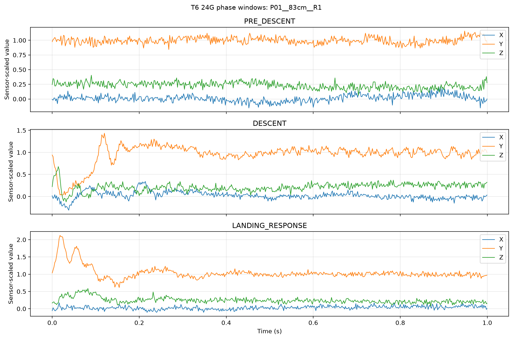
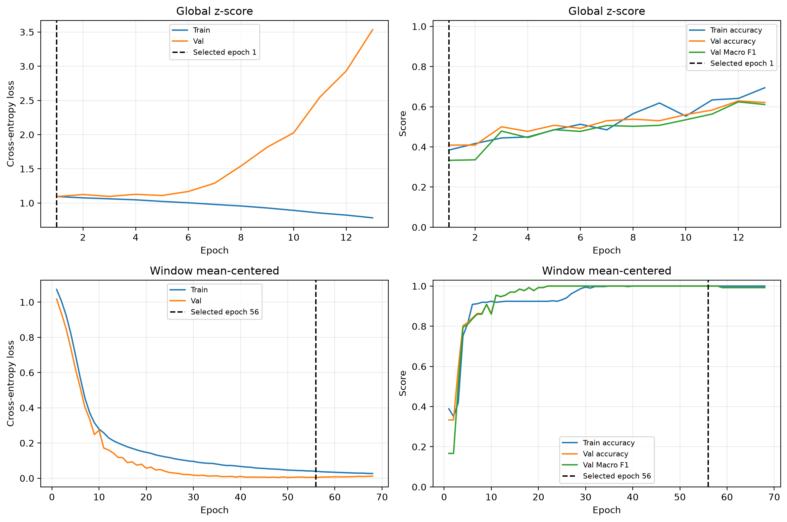
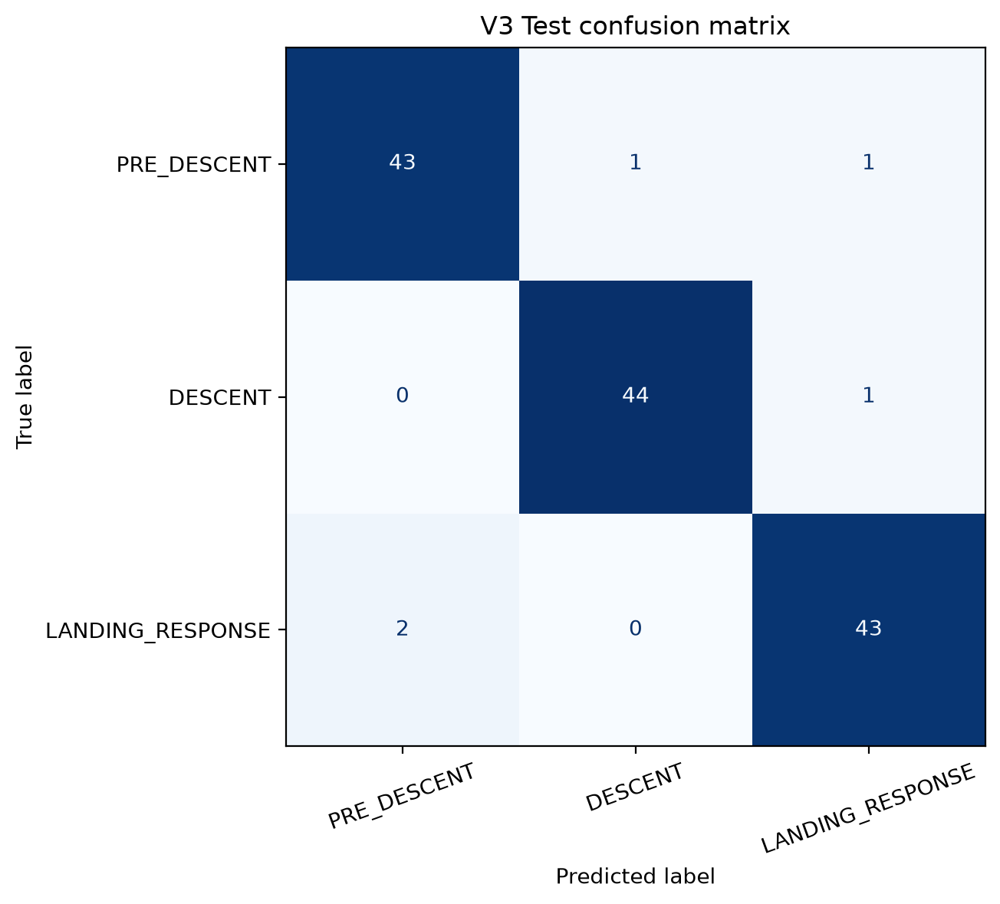

# 가속도 기반 동작 분류 — 1D CNN

**석사 연구에서 수집한 3축 가속도 데이터를 활용한 동작 구간 분류 프로젝트**

흉추 T6에서 측정한 가속도 신호로 **하강 전·하강 시작·착지 반응**을 구분할 수 있는지 확인했습니다. 원신호 QC부터 동작 구간 정의, 전처리 비교, 참가자 단위 평가와 오답 검토까지 진행했습니다.

| 분석 대상 | 모델 입력 | 분류 대상 |
|---|---|---|
| 15명 · 221 trial | 1초 · XYZ 3채널 · 1,500 Hz | 하강 전 / 하강 시작 / 착지 반응 |

윈도우별 평균 제거를 적용한 모델의 **Val Macro F1은 1.0000**, **Test Macro F1은 0.9630**이었습니다. Test 결과는 이전 실험에서 확인한 참가자를 재사용한 **탐색적 재평가**입니다.

## 1. Pipeline

원신호 QC 및 경계 검토 → 참가자 단위 데이터 분할 → 1초 윈도우 추출 → 전처리 비교 → CNN 학습·평가 → 오답 파형 검토

## 2. Data & QC

처음 보는 참가자의 동작을 분류하는 성능을 평가하기 위해, 같은 참가자의 데이터가 Train·Val·Test에 섞이지 않도록 분리했습니다.

| 구분 | 참가자 수 | 최종 trial 수 | 1초 윈도우 수 |
|---|---:|---:|---:|
| Train | 9 | 132 | 396 |
| Val | 3 | 44 | 132 |
| Test | 3 | 45 | 135 |

분석에 포함할 trial은 신호 품질, 동작 경계의 명확성, 추출 가능한 구간 길이를 기준으로 검토했습니다.

| 검토 항목 | 제외 사유 | 반영 결과 |
|---|---|---|
| 신호 품질 | 심한 freeze·clipping | Val 45 → 44 trial |
| 동작 경계 | 하강 종료 경계를 하나로 확정하기 어려움 | Train 135 → 134 trial |
| 구간 길이 | 착지 반응 1초 확보 불가 | Train 134 → 132 trial |

Test는 기존 QC 검토와 승인 기록을 반영한 45 trial을 사용했습니다. 각 trial에서 세 윈도우를 추출했지만, 이를 서로 독립적인 세 trial로 간주하지 않았습니다.

## 3. Methodology

### 동작 구간 정의

비디오와 신호를 함께 검토해 하강 시작·종료 경계를 확정했습니다. 하강 구간은 움직임이 시작되는 패턴을 분석하기 위해 **하강 시작 직후 1초**로 정의했습니다.

| 클래스 | 추출 구간 |
|---|---|
| PRE_DESCENT | 하강 시작 직전 1초 |
| DESCENT | 하강 시작 직후 1초 |
| LANDING_RESPONSE | 하강 종료 직후 1초 |

각 윈도우의 입력 크기는 **`(3, 1500)`**으로, XYZ 3채널에 각각 1,500개 샘플이 들어갑니다.

*예시 trial의 정규화 전 XYZ 신호. 시간축은 각 윈도우 시작을 기준으로 표시했습니다.*

### 전처리 비교

윈도우마다 다른 평균 수준을 제거했을 때, 구간 내 변화 패턴을 학습하는 데 도움이 되는지 비교했습니다.

| 방식 | 평균 제거 | 표준편차 스케일링 |
|---|---|---|
| Global z-score | Train 전체의 축별 평균 사용 | Train 전체의 축별 표준편차 사용 |
| Window mean-centering | 각 윈도우의 축별 평균 사용 | 평균 제거된 Train 전체의 축별 표준편차 사용 |

두 방식은 원신호에 각각 적용했습니다. Global z-score는 Train에서 구한 평균·표준편차를 Val/Test에도 사용했습니다. Window mean-centering은 각 입력 윈도우의 평균을 제거한 뒤, Train에서 구한 표준편차로 나눴습니다.

### 모델과 학습 설정

작은 1D CNN을 구성하고, 모델 구조와 학습 설정을 유지한 상태에서 전처리 방식을 비교했습니다.

**Conv1d → ReLU → MaxPool1d → Conv1d → ReLU → MaxPool1d → AdaptiveAvgPool1d → Linear**

| 항목 | 설정 |
|---|---|
| Conv1d 출력 채널 | 16 → 32 |
| 커널 크기 | 15 → 7 |
| 최종 출력 | 세 동작 구간의 분류 점수 |
| Batch size | 32 |
| Loss / Optimizer | Cross-entropy / Adam |
| Learning rate | 0.001 |
| 최대 Epoch | 100 |
| Early stopping | Val loss 기준 · patience 12 · min_delta 0.0001 |

별도의 하이퍼파라미터 튜닝은 수행하지 않았습니다.

## 4. Results

### Val: 전처리 방식 비교

각 방식에서 Val loss를 기준으로 선택한 모델의 결과입니다.

| 전처리 | Accuracy | Macro F1 |
|---|---:|---:|
| Global z-score | 0.4091 | 0.3330 |
| Window mean-centering + Train 표준편차 스케일링 | **1.0000** | **1.0000** |

평균 제거 모델은 **epoch 56**에서 최적 Val loss **0.0041**을 기록했고, 이후 개선 없이 **epoch 68**에서 학습을 종료했습니다. 이번 실험에서는 윈도우별 평균 제거를 적용했을 때 더 높은 Val 성능을 보였습니다.

*위: Global z-score / 아래: Window mean-centering. 점선은 Val loss를 기준으로 선택한 epoch입니다.*

### Test: 탐색적 재평가

선택한 평균 제거 모델을 저장한 뒤, 가중치를 수정하지 않고 Train 기준의 전처리를 적용해 평가했습니다.

| Accuracy | Macro F1 | 오답 윈도우 |
|---:|---:|---:|
| **0.9630** | **0.9630** | **5 / 135** |

**Test 참가자는 Train/Val과 분리되어 있지만, 이전 구간 설정 실험에서 이미 확인한 대상입니다.** 따라서 새로운 미사용 Test를 통한 최종 검증으로 해석하지 않았습니다.

*행: 실제 클래스 / 열: 예측 클래스. 총 135개 윈도우 중 130개 정분류.*

## 5. Error Review & Limitations

오답 5개 윈도우의 원신호를 확인했으며, 일부에서 **XYZ 값이 동시에 일정하게 유지되는 구간**을 관찰했습니다. 이를 통해 신호 고정 구간의 지속시간을 QC 항목으로 명시하고, 전체 데이터에 일관되게 적용할 필요성을 확인했습니다.

다만, 해당 신호 양상이 오분류의 직접적인 원인인지는 검증하지 않았습니다. QC 기준을 강화한 뒤 재학습하거나 성능 개선 여부를 비교하는 실험도 수행하지 않았습니다.

- **평가 범위:** 참가자 15명, 단일 데이터 분할에서 확인한 결과입니다.
- **Test 재사용:** 기존에 확인한 Test 대상에 대한 탐색적 결과입니다.
- **적용 범위:** 확정된 동작 경계에서 추출한 구간을 분류했습니다. 연속 신호의 이벤트 탐지와 실시간 인식은 검증하지 않았습니다.

## 6. My Contribution & AI Use

AI와 설계·구현을 논의하며 진행한 개인 프로젝트입니다.

| 구분 | 수행 내용 |
|---|---|
| 직접 수행 | 분석 목적과 구간 정의, QC·경계 수동 검토, 로컬 학습 실행, 원신호 확인과 결과 해석 |
| AI 활용 | 모델·전처리 설계 논의, 코드 작성·디버깅 지원, CNN 개념 학습, 문서 정리 |

## 7. Repository & Usage

| 파일 | 내용 |
|---|---|
| [t6_phase_cnn_portfolio.ipynb](t6_phase_cnn_portfolio.ipynb) | 분석 코드, 세부 설정, 학습 로그, 평가 및 오답 검토 |
| `figures/phase_windows.png` | 세 동작 구간의 예시 파형 |
| `figures/learning_curves.png` | 전처리별 학습곡선 |
| `figures/test_confusion_matrix.png` | Test 혼동행렬 |

노트북에 저장된 실행 결과를 통해 분석 과정을 확인할 수 있습니다. 참가자 ID는 `P01` 등의 가명으로 치환하고 개인 경로를 제거했습니다. 파형 이미지에서는 제목의 식별 정보만 수정했습니다.

원신호, 경계 CSV, 전용 로더(`analyze_mvic.py`), checkpoint 및 원본 ID 대응표는 포함하지 않았습니다.

전체 재실행 조건

이 저장소만으로 전체 Run All을 실행할 수는 없습니다. 저장된 출력은 로컬 실행 결과를 공개용으로 정리한 것입니다.

전체 재실행에는 다음 조건이 필요합니다.

- 원신호와 경계 CSV, 전용 로더 및 의존 패키지 준비
- 데이터 ID·경로와 코드의 가명 표기 일치
- `T6_PROJECT_DIR` 환경변수로 데이터 루트 지정 — 기본값 `./private_data`

기존 checkpoint가 있으면 저장된 모델을 불러와 평가합니다.

